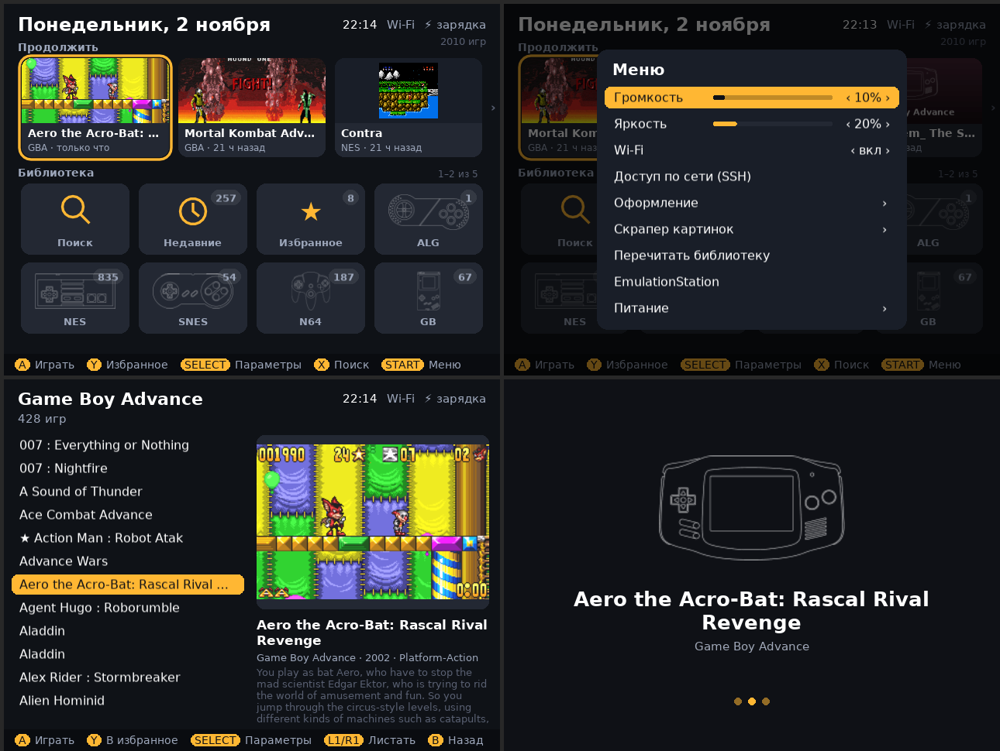
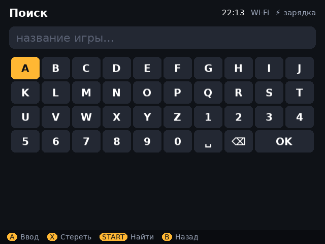
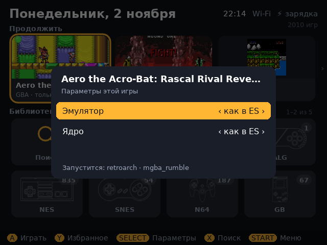
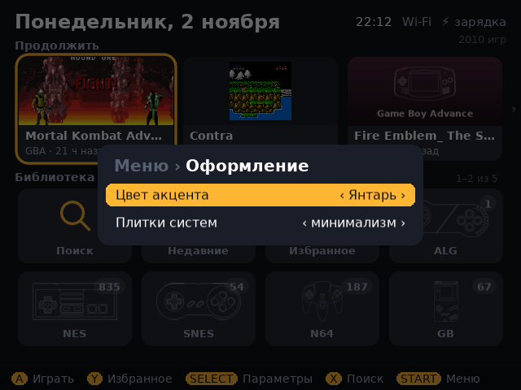

# Home — главный экран для R36H

Свой лаунчер для ретро-портативки **R36H** на прошивке **ArkOS** вместо стандартного меню
EmulationStation. Написан на LÖVE 11.4, который уже есть в ArkOS — ставить ничего не нужно.

Показан в конце ролика «Топ 12 игр GBA на 10 минут: во что играть на R36H»
на канале [AlexLabax](https://www.youtube.com/@alexlabax).



| Поиск | Параметры игры (SELECT) | Оформление |
|---|---|---|
|  |  |  |

## Что умеет

- **Главный экран:** «Продолжить» — последние игры, библиотека плитками систем с числом игр,
  поиск, недавние, избранное.
- **Список игр** с обложками и описаниями из gamelist EmulationStation.
- **Меню Home:** громкость, яркость, Wi‑Fi, доступ по сети (SSH) — без походов в настройки.
  Оформление (цвет акцента, вид плиток), питание (сон, перезагрузка, выключение).
- **Скрапер картинок** — обложки и скриншоты с thumbnails.libretro.com.
- **Свой экран запуска** игры вместо «ArkOS now loading».
- Игры запускаются **теми же командами, что в EmulationStation**: эмулятор, ядро и режим
  процессора берутся из ваших настроек ES. Параметры системы и игры — на SELECT.
- Выход в EmulationStation — из меню, одним пунктом.

**Экономнее в простое.** Стандартное меню в простое грузит одно ядро процессора на ~33%,
Home — на 1,4–1,8%. Ток в меню: ~750 мА у EmulationStation против ~540 мА у Home
с включённым Wi‑Fi и ~440 мА с выключенным. Замерено на моей приставке; часы работы
от батареи не мерил.

## Установка

Проверено на R36H с ArkOS 2.0 (AeUX). На других клонах R36S с ArkOS скорее всего тоже
заработает, но не проверялось.

1. Скопируйте папку репозитория на приставку — на карту в раздел `roms` или по SSH/Samba
   (в ArkOS: Options → Enable Remote Services).
2. На приставке, из этой папки (по SSH или через терминал):

   ```bash
   bash install.sh
   ```

   Home появится в **Ports → Home**. EmulationStation остаётся главным меню.

3. Чтобы приставка сразу загружалась в Home (со своим загрузочным видео и службой питания):

   ```bash
   bash install.sh --boot
   ```

   Вернуть всё как было: `sudo bash system/install.sh uninstall`.

## Управление

| Кнопка | Что делает |
|---|---|
| Крестовина | выбор |
| A | открыть / играть |
| B | назад |
| X | поиск |
| Y | в избранное |
| SELECT | параметры системы или игры |
| START | меню Home |
| L1 / R1 | листать список |

## Известные проблемы

- Не открываются PSP и сам RetroArch.
- При входе в игру сбрасывается громкость, выставленная в Home.
- После выхода в EmulationStation игры оттуда показывают экран запуска последней игры из Home.

## Как устроено

- `home/app/main.lua` — интерфейс; `library.lua` — разбор `es_systems.cfg` и gamelist,
  сборка команды запуска; `scrape.lua` — скрапер; `logo.lua` — логотип и анимация.
- `home/Home.sh` — запускает экран; экран пишет команду ES в `/tmp/home_launch.sh`
  и выходит, скрипт её выполняет и снова открывает экран.
- `system/` — загрузка в Home вместо ES (`boot.sh`), Wi‑Fi и SSH (`net.sh`),
  служба питания (`powerd.py`: выключает усилитель в тишине, пишет журнал батареи).
- `bootanim/` — как собрано загрузочное видео `system/boot.mp4`.

## Лицензия

Код — MIT (см. `LICENSE`). Силуэты геймпадов в `home/app/pads/` — из темы
[es-theme-carbon](https://github.com/RetroPie/es-theme-carbon) (автор Rookervik),
CC BY-NC-SA: только некоммерческое использование.

---

**English.** Home is a custom launcher for the R36H handheld running ArkOS, written in LÖVE 11.4
(already shipped with ArkOS). It replaces the EmulationStation menu with a tile-based home screen,
a quick menu (volume, brightness, Wi‑Fi, SSH), a libretro thumbnail scraper and its own game
loading screen, and launches games with exactly the same commands as EmulationStation.
Install: copy the repo to the device and run `bash install.sh` (adds Ports → Home) or
`bash install.sh --boot` (boot straight into Home). The UI is in Russian.
